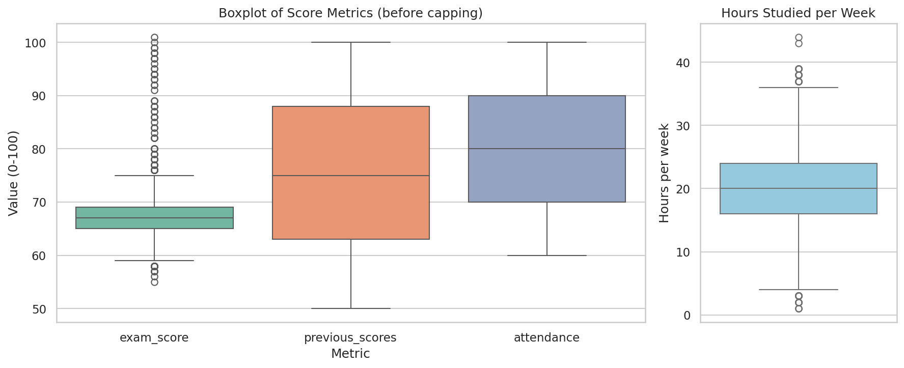
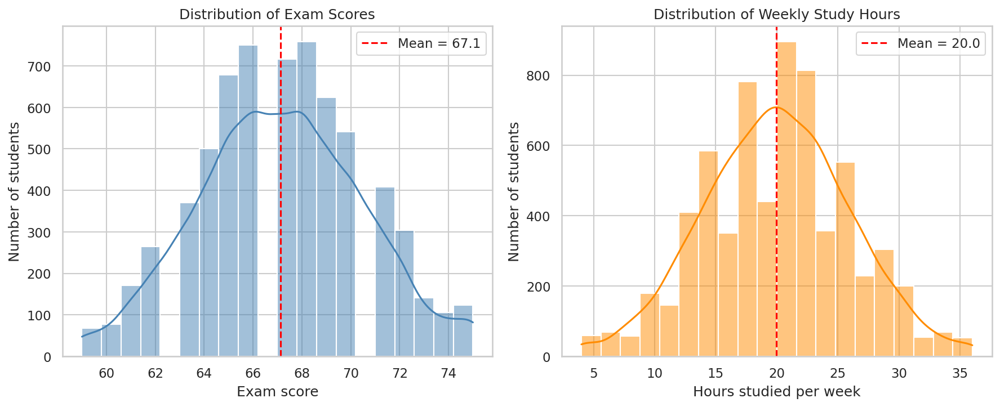
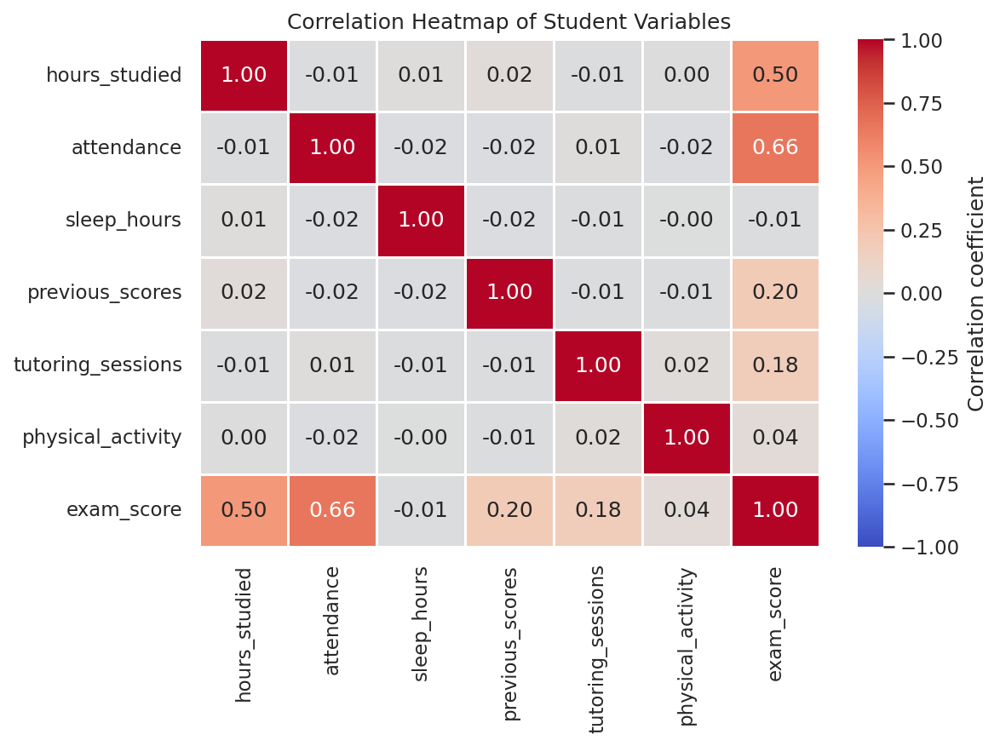
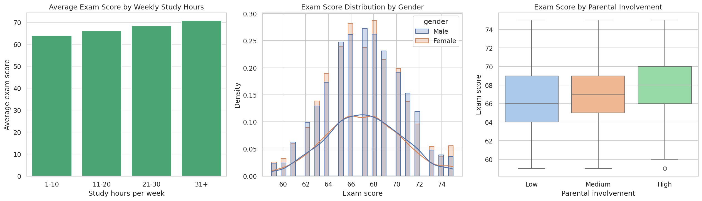
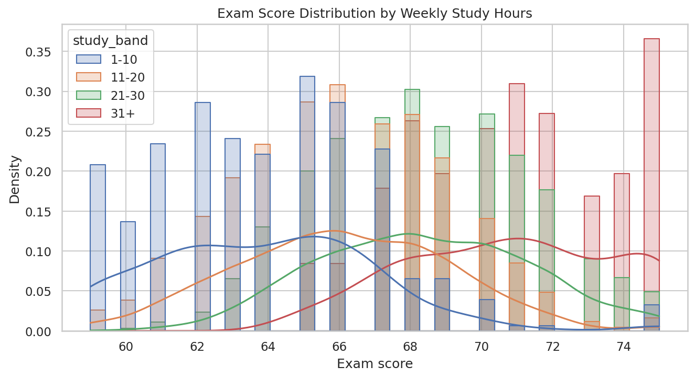

# Student Exam Performance Data Visualizer

- **Author:** Teki Mohit Sai Tulasi
- **Program:** GetIntern.in 8-Week Practical Data Science & ML Internship
- **Phase 1 / Week 3 Milestone Project:** Visual Outlier Detection & Correlation Heatmaps

A Python notebook that uses **Pandas, Matplotlib and Seaborn** to find outliers in student exam data, explore score distributions across study hours and demographic groups, and identify which variables correlate most strongly with high grades.

## Repository Contents
| File | Description |
|------|-------------|
| `student_exam_performance_visualizer.ipynb` | Fully executed notebook with visible outputs |
| `StudentPerformanceFactors.csv` | Raw dataset (6,607 rows, 20 columns) |
| `cleaned_student_performance.csv` | Dataset after cleaning and outlier capping |
| `boxplot.png` | Chart 1: Boxplot |
| `distribution.png` | Chart 2: Distribution plot |
| `heatmap.png` | Chart 3: Correlation heatmap |
| `distribution_breakdowns.png` | Additional chart: breakdowns by study hours, gender, parental involvement |
| `distribution_by_study_hours.png` | Additional chart: score distribution per study-hours group |
| `README.md` | Project documentation |

## Dataset
Source: *Student Performance Factors* (Kaggle) - https://www.kaggle.com/datasets/lainguyn123/student-performance-factors

6,607 students with 20 columns, including `hours_studied`, `attendance`, `previous_scores`, `sleep_hours`, `tutoring_sessions`, `gender`, `parental_involvement` and the target `exam_score`.

## Data Preparation
- No duplicate rows were found.
- 235 missing values in three categorical columns (`teacher_quality` 78, `parental_education_level` 90, `distance_from_home` 67) were filled with the **mode**. Numeric columns are filled with the **median** if missing (none were).
- After cleaning: 6,607 rows, 0 nulls.

---

# Required Charts

## Chart 1: Boxplot (Outlier Identification)
Outliers are values below Q1 - 1.5 x IQR or above Q3 + 1.5 x IQR. Extreme values were capped to these bounds.



- `exam_score` has **104 outliers** (bounds 59 to 75), mostly unusually high scores up to 101, which is above the 100-point maximum.
- `hours_studied` has **43 outliers** (bounds 4 to 36), while `previous_scores` and `attendance` have none.
- Capping the extremes to the IQR bounds kept every student in the data (6,607 rows) while limiting the effect of anomalies.

| Column | Lower bound | Upper bound | Outliers | Observed range |
|--------|------------:|------------:|---------:|----------------|
| exam_score | 59 | 75 | 104 | 55 - 101 |
| hours_studied | 4 | 36 | 43 | 1 - 44 |
| previous_scores | 25.5 | 125.5 | 0 | 50 - 100 |
| attendance | 40 | 120 | 0 | 60 - 100 |

## Chart 2: Distribution Plot (Scores and Study Hours)


- After capping, exam scores are bell-shaped and centered near **67.1**, with most students scoring between about 63 and 71.
- Weekly study hours are also roughly bell-shaped with a mean of about **20 hours**.
- Most students study between roughly 12 and 28 hours a week, so very light and very heavy study loads are rare.

## Chart 3: Correlation Heatmap


- **Attendance** has the strongest correlation with exam score (r = 0.66), followed by **hours studied** (r = 0.51).
- Previous scores (0.20) and tutoring sessions (0.18) show weak positive relationships, while sleep hours (-0.01) and physical activity (0.04) show almost none.
- The predictors are nearly uncorrelated with each other, so each one contributes independently.

| Variable | Correlation with exam score |
|----------|----------------------------:|
| attendance | 0.661 |
| hours_studied | 0.505 |
| previous_scores | 0.196 |
| tutoring_sessions | 0.175 |
| physical_activity | 0.037 |
| sleep_hours | -0.014 |

---

# Additional Charts

## Breakdowns by Study Hours and Demographics


- Average exam score rises steadily with study time, from about 64 for 1-10 hours to about 71 for 31+ hours.
- Male and female score distributions almost overlap, so gender shows little effect.
- Median scores increase from Low (66) to Medium (67) to High (68) parental involvement.

## Score Distribution by Study Hours


- Each study-hours group has its own score curve, and the curves shift right as study time increases.
- Students studying 1-10 hours cluster around 59 to 66, while the 31+ hour group is concentrated at 70 to 75.
- The groups overlap, so more study raises scores on average but does not guarantee a high score.

---

## Key Takeaways
- Attendance and study time matter most for exam performance in this dataset.
- Capping limited the influence of 104 extreme exam scores, including impossible values above 100.
- Correlation does not prove causation; these are patterns in the data.

## How to Run
```bash
pip install pandas numpy matplotlib seaborn jupyter
jupyter notebook student_exam_performance_visualizer.ipynb
```
Place `StudentPerformanceFactors.csv` in the same folder and run all cells from top to bottom.

## Tech Stack
Python 3, Pandas, NumPy, Matplotlib, Seaborn, Jupyter Notebook
